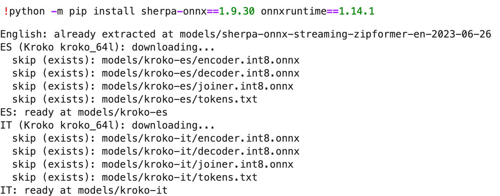

This report documents the prototype speech interface built for the client's airport virtual assistant (Task 4.1) and closes with a comparison against an ASR system deployed in the e-commerce industry (Task 4.2). The prototype is a Python application that recognises short travel phrases in English, Spanish and Italian entirely on the local machine, is evaluated on the client's fifteen recorded phrases plus two recordings made by the author, and reports a word error rate (WER) for every file.

# The ASR package and its configuration

The module's suggested engine, Mozilla DeepSpeech 0.9.3, has been archived and unmaintained since 2021^[Mozilla, *DeepSpeech* 0.9.3 (2020), `github.com/mozilla/DeepSpeech`; repository archived, last release December 2020.], which makes it a poor foundation for a kiosk the client must operate for years. **sherpa-onnx** 1.9.30^[k2-fsa project, *sherpa-onnx* v1.9.30, `github.com/k2-fsa/sherpa-onnx`.], the deployment runtime of the k2/icefall speech ecosystem, was therefore selected: it is actively maintained, runs entirely offline as the client requires, and executes neural transducer models^[A. Graves, "Sequence transduction with recurrent neural networks," ICML Workshop on Representation Learning, 2012. arXiv:1211.3711.] through `onnxruntime` 1.14.1 on a plain CPU. Both packages are pinned by version and installed under Python 3.7, matching the module's Coursera environment (Figure 1).

Language selection is a dictionary that maps each of the three languages to its own recognizer, each built from a model bundle on local disk: a streaming Zipformer transducer^[Z. Yao et al., "Zipformer: A faster and better encoder for automatic speech recognition," Proc. ICLR, 2024. arXiv:2310.11230.] for English and Kroko `kroko_64l` transducers for Spanish and Italian. In every case the int8-quantised weights are kept because they are smaller and faster on kiosk-class hardware. Each recognizer is created with `OnlineRecognizer.from_transducer(...)` configured for greedy-search decoding, the CPU provider and two threads.

{width=100%}

# Handling the noisy environment

An airport concourse combines low-frequency rumble (ventilation, engines, rolling luggage) with speakers standing at unpredictable distances from the microphone. The application therefore cleans every utterance with a three-stage `preprocess()` chain before decoding. First, an order-4 Butterworth high-pass filter at 80 Hz removes the rumble band, which sits below the fundamental frequency of adult speech; it is applied forwards and backwards (`sosfiltfilt`), so the filtering is zero-phase and does not smear phoneme boundaries. Second, the signal is RMS-normalised to −20 dBFS under a 0.97 peak ceiling, giving every speaker the same effective loudness without clipping. Third, 0.8 s of very-low-amplitude noise is prepended so the streaming decoder's internal state settles before the first phoneme arrives, and 2 s of trailing silence flushes the final words out of the stream.

Figure 2 shows the chain acting on one of the author's recordings, and Figure 3 shows why it matters: on raw audio the decoder truncates sentence onsets ("THE RESTAURANTS AND SHOPS") and mis-hears "plane" as "PLAYING"; on preprocessed audio both sentences are recovered. The chain raises signal-to-noise ratio and level consistency; what it cannot do is repair vocabulary-level confusions, as the next section shows.

```{=latex}
\medskip
\begin{fullwidth}
\refstepcounter{figure}%
\noindent\includegraphics[width=\linewidth]{figures/fig2-preprocess.png}
\par\smallskip
\noindent\parbox{\linewidth}{\footnotesize Figure~\thefigure: The preprocessing chain applied to \texttt{own\_sentence1.wav} (16\,kHz laptop recording). Top row: RMS normalisation raises speech to $-20$\,dBFS within a 0.97 peak ceiling; the shaded band is the 0.8\,s lead-in pad. Bottom row: the zero-phase order-4 high-pass removes all energy below 80\,Hz (dashed line) while the speech band is untouched.}
\end{fullwidth}
\medskip
```

```{=latex}
\medskip
\refstepcounter{figure}%
\noindent\marginnote{Figure~\thefigure: Raw versus preprocessed decodes of two client files: preprocessing recovers the truncated onset of \texttt{where.wav} and repairs \texttt{what\_time.wav}.}%
\includegraphics[width=\linewidth]{figures/fig3-raw-vs-clean.png}
\medskip
```

# Test results and analysis

Every file is decoded after preprocessing and compared with the client's reference transcription. Hypothesis and reference are normalised first (lower-cased, accents and punctuation stripped) so that formatting differences do not count as errors; a word-level Levenshtein alignment then yields substitutions $S$, deletions $D$ and insertions $I$ over $N$ reference words.

```{=latex}
\medskip
\begin{fullwidth}
\refstepcounter{table}%
\noindent\parbox{\linewidth}{\footnotesize Table~\thetable: Per-file word error rate after preprocessing, computed as $\mathrm{WER}=\frac{S+D+I}{N}\times 100$. Corpus WER: English 14.7\,\%, Spanish 0.0\,\%, Italian 0.0\,\%.}
\par\smallskip
\noindent\begin{tabular*}{\linewidth}{@{\extracolsep{\fill}}lll@{}}
\toprule
Language & File & WER \\
\midrule
English & checkin.wav & 33.3\,\% \\
English & parents.wav & 0\,\% \\
English & suitcase.wav & 33.3\,\% \\
English & what\_time.wav & 20.0\,\% \\
English & where.wav & 0\,\% \\
Spanish & checkin\_es.wav & 0\,\% \\
Spanish & parents\_es.wav & 0\,\% \\
Spanish & suitcase\_es.wav & 0\,\% \\
Spanish & what\_time\_es.wav & 0\,\% \\
Spanish & where\_es.wav & 0\,\% \\
Italian & checkin\_it.wav & 0\,\% \\
Italian & parents\_it.wav & 0\,\% \\
Italian & suitcase\_it.wav & 0\,\% \\
Italian & what\_time\_it.wav & 0\,\% \\
Italian & where\_it.wav & 0\,\% \\
English & own\_sentence1.wav & 0\,\% \\
Spanish & own\_sentence2.wav & 0\,\% \\
\bottomrule
\end{tabular*}
\end{fullwidth}
\medskip
```

Spanish and Italian are recognised perfectly. English accounts for every remaining error (corpus WER 14.7 %), and inspection of Figure 5 shows the errors are near-homophone and tokenisation failures rather than noise: "check-in desk" decodes as "CHICKEN DESK" (one substitution plus one deletion once the hyphen is split), "suitcase" splits into "SUIT CASE", and one utterance gains a leading "AT". Preprocessing cannot fix these errors, which are vocabulary and segmentation limits of the compact streaming English model, but it did eliminate every onset-truncation error in the corpus.

The two personal recordings were made on a laptop microphone. Figure 4 shows the raw decode of `own_sentence1.wav` mis-hearing three words ("WERE I CONFINED A TAXI"); after preprocessing the transcription is exact, and both personal recordings finish at 0 % WER (Figure 5).

```{=latex}
\medskip
\refstepcounter{figure}%
\noindent\marginnote{Figure~\thefigure: The author's two recordings: preprocessing turns a three-word mis-hearing of \texttt{own\_sentence1.wav} into an exact transcription.}%
\includegraphics[width=\linewidth]{figures/fig4-own-recordings.png}
\medskip

\medskip
\refstepcounter{figure}%
\noindent\marginnote{Figure~\thefigure: Per-file scores and per-language corpus WER as printed by the evaluation notebook.}%
\includegraphics[width=0.88\linewidth]{figures/fig5-wer-summary.png}
\medskip
```

# ASR in e-commerce: Alibaba's Paraformer

Alibaba's shopping platforms have run customer service on speech for years: by 2017 the AliMe assistant was already serving millions of voice- and text-based customer questions per day^[F.-L. Li et al., "AliMe Assist: An intelligent assistant for creating an innovative e-commerce experience," Proc. CIKM, 2017. doi:10.1145/3132847.3133169.]. The current generation of Alibaba's speech services is built on **Paraformer**^[Z. Gao, S. Zhang, I. McLoughlin and Z. Yan, "Paraformer: Fast and accurate parallel transformer for non-autoregressive end-to-end speech recognition," Proc. INTERSPEECH, 2022. arXiv:2206.08317.], a non-autoregressive model introduced in 2022 that emits the whole token sequence in a single parallel pass: a continuous integrate-and-fire predictor estimates how many tokens the audio contains, and a glancing language model sampler captures the dependencies between them. This yields accuracy comparable to an autoregressive transformer with more than 10× faster decoding, the property that matters when one GPU fleet must transcribe a contact centre. The production model, trained on 60,000 h of industrial Mandarin, is released through the FunASR toolkit together with voice-activity detection and punctuation models^[Z. Gao et al., "FunASR: A fundamental end-to-end speech recognition toolkit," Proc. INTERSPEECH, 2023. arXiv:2305.11013.], and the SeACo extension adds hotword customisation so merchants' product and brand names decode correctly^[X. Shi et al., "SeACo-Paraformer: A non-autoregressive ASR system with flexible and effective hotword customization ability," Proc. ICASSP, 2024. arXiv:2308.03266.].

The contrast with the kiosk prototype is instructive: both are end-to-end neural systems deployed as quantised inference graphs, but the airport assistant needs low-latency word-by-word decoding on a single offline CPU (a streaming transducer), whereas Alibaba optimises server-side throughput over millions of utterances (non-autoregressive batch decoding). Its hotword mechanism is also exactly what the prototype's English model lacks for terms like "check-in".

# Appendix: acoustic model details

Model bundles (encoder/decoder/joiner + tokens,
int8 ONNX):

    EN  sherpa-onnx-streaming-zipformer
        -en-2023-06-26 (k2-fsa releases)
    ES  kroko-es, variant kroko_64l
    IT  kroko-it, variant kroko_64l
        (huggingface.co/hudaiapa88)

All three bundles are streaming neural transducers with the same three-part layout. The encoder converts log-mel filter-bank frames into acoustic states while consuming the audio in fixed chunks with bounded left context, which is what makes partial results available while the speaker is still talking. The decoder is a small stateless predictor that embeds the most recently emitted tokens, and the joiner combines encoder and decoder states to score the next token; greedy search keeps the best-scoring token frame by frame.

The English encoder is a Zipformer, a U-Net-like refinement of the Conformer that processes the sequence at several frame rates; its file names record the streaming configuration (16-frame chunks, 128 frames of left context) and its token table holds byte-pair units (`bpe.model`). The Spanish and Italian Kroko bundles ship the identical encoder/decoder/joiner layout with language-specific token tables and load through the same `OnlineRecognizer` API.
